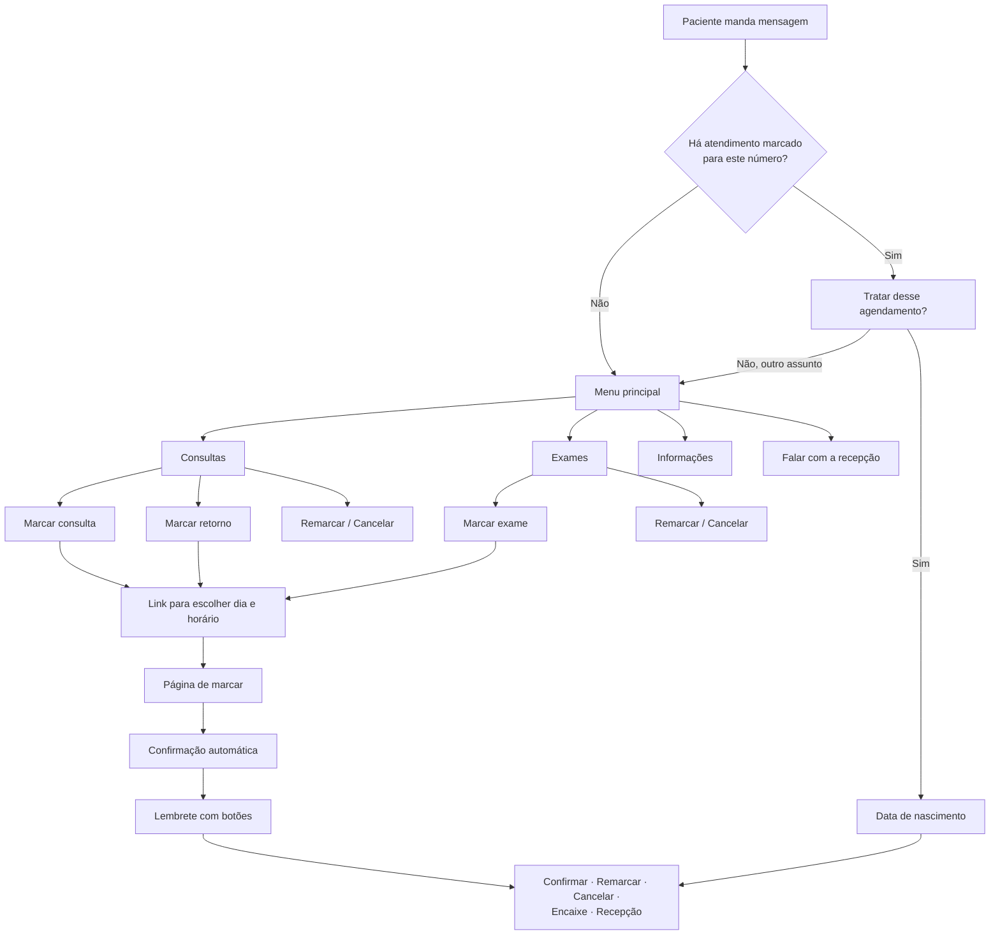

# Jornada do bot no WhatsApp

O caminho do paciente no WhatsApp da clínica, do primeiro "Oi" até a recepção. Fonte: Tecnologia › Jornada do bot
(`src/components/admin/tecnologia/botJourney.ts`, atualizada em **30/10/2026**), que espelha o bot em
`src/lib/data/whatsapp/bot/` e as mensagens automáticas. Mudou a jornada, atualizar os dois no mesmo commit.

**Quem age em cada passo**

| Marca | Quem |
|---|---|
| 🧑 **Paciente** | o que o paciente manda ou toca |
| 🤖 **Bot** | resposta do bot na conversa |
| 🔍 **O bot confere** | decisão do bot (o caminho se divide) |
| 🌐 **Página de marcar** | página aberta pelo link, com a agenda real |
| ✉️ **Mensagem automática** | sai sozinha, sem ninguém da equipe |
| 🏥 **Recepção** | a equipe da clínica |

## Visão geral

Menu principal: **Consultas · Exames · Informações · Falar com a recepção** (só aparecem as opções que a clínica usa).

## 1. Começo da conversa

O paciente manda qualquer mensagem para o número da clínica, a qualquer hora.

1. 🧑 "Oi" (ou qualquer mensagem).
2. 🔍 Há atendimento marcado para este número?
   - **Não**
     1. 🤖 "Olá! 👋 Aqui é [clínica]."
     2. 🤖 Menu principal. *Só aparecem as opções que a clínica usa.*
   - **Sim**
     1. 🤖 Boas-vindas e "Identificamos um agendamento associado a este número. Você deseja tratar desse agendamento?"
     2. 🧑 Sim, quero. *"Não, outro assunto": vai para o menu principal.*
     3. 🤖 Pede a data de nascimento do paciente, por segurança. *Nada do atendimento aparece antes disso.*
     4. 🔍 A data confere com um paciente com atendimento? *Não: Falar com a recepção · Tentar outra data · Voltar ao
        menu.*
     5. 🤖 Mostra o atendimento (dia e hora) e pergunta o que fazer: **Confirmar presença · Remarcar · Cancelar ·
        Encaixe ou antecipar · Falar com a recepção**.

## 2. Marcar consulta ou exame

Consultas › Marcar consulta, ou Exames › Marcar exame. O dia e o horário são escolhidos numa página, com a agenda real.

1. 🤖 Qual consulta (ou exame) você quer marcar? *Lista dos serviços, sempre mostrada, mesmo com um só.*
2. 🔍 O serviço tem horário livre no prazo da agenda?
   - **Não:** 🤖 "No momento não há horários livres"; a recepção assume a conversa.
   - **Sim**
     1. 🤖 Com qual profissional? (ou "Primeiro horário"). *Só quando mais de um profissional atende o serviço.*
     2. 🤖 Consultório ou atendimento domiciliar? *Só quando o serviço tem os dois. Domiciliar: pede e confirma o
        endereço.*
     3. 🤖 É para você ou para outra pessoa? *Clínica pediátrica: só no exame.*
     4. 🤖 Identifica o paciente: escolhe um já cadastrado ou informa nome e data de nascimento. *Na primeira vez, o nome
        de quem escreve. Menor de 18 anos marcando para si: só pelo responsável. Idade limite do serviço conferida.*
     5. 🔍 O paciente já tem esse atendimento marcado?
        - **Sim:** 🤖 Avisa o dia marcado e indica Remarcar.
        - **Não**
          1. 🤖 Manda o link para escolher dia e horário. *O link vale 30 minutos.*
          2. 🌐 Escolhe o dia e o horário livres e confirma.
          3. ✉️ Confirmação da marcação, com dia, hora e local.
          4. ✉️ Preparo do exame (texto ou arquivo) ou orientações da consulta. *Quando o serviço tem.*

## 3. Marcar retorno

Consultas › Marcar retorno. Só para quem tem direito, com o profissional da consulta de origem.

1. 🔍 Algum paciente deste número tem consulta recente, dentro do prazo do retorno, sem retorno marcado?
   - **Não:** 🤖 Explica o motivo (prazo vencido, retorno já usado, consulta domiciliar) e indica Marcar consulta.
   - **Sim**
     1. 🤖 Valor do retorno, prazo e "Para qual paciente é o retorno?"
     2. 🤖 Manda o link, com datas só até o fim do prazo.
     3. 🌐 Escolhe o dia e o horário.
     4. ✉️ Confirmação da marcação.

## 4. Remarcar ou cancelar

Pelo menu (Consultas ou Exames), pela entrada da conversa ou pelos botões do lembrete.

1. 🔍 Há atendimento futuro neste número? *Não: avisa e volta ao menu.*
2. 🤖 Pede a data de nascimento e mostra o atendimento. *Pelo lembrete, vai direto ao atendimento do lembrete.*
   - **Remarcar**
     1. 🤖 Domiciliar: confirma o endereço. Retorno: confere o prazo.
     2. 🤖 Manda o link para o novo dia e horário.
     3. 🌐 Escolhe o novo horário.
     4. ✉️ Confirmação da remarcação.
   - **Cancelar**
     1. 🤖 "Confirma o cancelamento?" Sim ou Não.
        - **Sim:** 🤖 "Prontinho, cancelamos…" → ✉️ A vaga é oferecida à lista de espera. *Com a Lista de espera
          ligada.*
        - **Não:** 🤖 Mantém o atendimento e pergunta se quer confirmar a presença.

## 5. Encaixe ou antecipar

Com a Lista de espera ligada: para quem quer um horário mais cedo do que o marcado.

1. 🤖 Pede a data de nascimento e mostra o atendimento. *Sem atendimento marcado: oferece marcar agora e entrar na
   lista depois.*
2. 🔍 Há horário livre antes do atendimento?
   - **Sim:** 🤖 "Quer antecipar para um destes?" → 🧑 Escolhe um horário (ou "Nenhum desses") → 🤖 Confirma e antecipa.
   - **Não:** 🤖 Entra na lista de espera. *Quem já está na lista pode sair.*
3. ✉️ Quando abre uma vaga antes: oferta da vaga com Sim e Não. *A vaga fica reservada para a pessoa enquanto ela pode
   responder.*

## 6. Informações

Só aparecem os itens que a clínica preencheu em Configurações.

1. 🤖 O que você gostaria de saber?
   - **Valores:** 🤖 Preço de cada serviço (consultório e domiciliar) e as formas de pagamento.
   - **Convênios:** 🤖 O texto de convênios da clínica.
   - **Endereço:** 🤖 Cada local, com o link do mapa.
   - **Preparo para exames:** 🤖 Escolhe o exame e recebe o preparo (texto ou arquivo).
   - **Outras informações:** 🤖 O texto de observações da clínica.
2. 🤖 Volta à lista de informações.

## 7. Depois de marcar

Mensagens que saem sozinhas, sem ninguém da equipe.

1. ✉️ Confirmação, com preparo ou orientações quando houver.
2. ✉️ Lembrete na véspera ou no dia (como a clínica escolher), com **Confirmar presença · Remarcar · Cancelar**.
   - **Confirmar presença:** 🤖 "Presença confirmada ✓" → 🏥 A agenda mostra a presença confirmada.
   - **Remarcar:** 🤖 Segue o caminho do Remarcar (item 4).
   - **Cancelar:** 🤖 Segue o caminho do Cancelar (item 4).
3. ✉️ Se a clínica bloquear o dia: aviso de cancelamento com o link para remarcar.

## 8. Quando a recepção entra

O número continua no WhatsApp Business da recepção. O bot sai de cena quando uma pessoa precisa atender.

1. 🔍 Por que a conversa vai para a recepção?
   - **O paciente pede:** 🧑 Toca em "Falar com a recepção" (ou escreve pedindo). *Escrito: o bot confirma antes.*
   - **O bot não entende:** 🤖 Na 4ª mensagem seguida que não entende, passa para a clínica. *Áudio, foto e figurinha:
     o bot avisa que só lê texto.*
   - **Não há o que marcar:** 🤖 Sem serviço ou sem horário livre: avisa que a recepção responde.
2. 🤖 "Vou te transferir para a recepção…"; o bot fica pausado nessa conversa.
3. 🏥 Responde pelo app WhatsApp Business, no celular ou no computador. *Responder pelo app também pausa o bot. A tela
   Atendimento mostra quem espera.*
4. 🏥 Manda **#bot** ou toca em "Devolver ao bot" no painel: o bot volta a atender essa conversa.

## Regras gerais

- A qualquer momento: "0" ou "Voltar ao menu" volta ao menu principal.
- Conversa parada por 15 minutos: o bot encerra com aviso; a próxima mensagem começa de novo.
- Os botões do lembrete e da oferta de vaga funcionam em qualquer ponto da conversa.
- Clínica em implantação: o bot não responde e nenhuma mensagem automática sai.
- Número sem WhatsApp Business (só no sistema): não há "Falar com a recepção".

## Mensagens automáticas (templates da Meta)

| Template | Quando sai |
|---|---|
| `rc_confirmacao_v1` | Confirmação da marcação |
| `rc_remarcacao_v1` | Confirmação da remarcação |
| `rc_cancelamento_v1` | Cancelamento |
| `rc_cancelamento_clinica_v1` | A clínica bloqueou o dia (com o link para remarcar) |
| `rc_lembrete_v1` | Lembrete com Confirmar presença · Remarcar · Cancelar |
| `rc_oferta_vaga_v1` | Vaga aberta para quem está na lista de espera |
| `rc_orientacoes_consulta_v1` | Orientações da consulta, fora da janela de 24h |
| `rc_preparo_exame_v3` | Preparo do exame em texto, logo depois da confirmação (quem só tem a v2 aprovada segue com ela) |
| `rc_preparo_arquivo_v3` | Preparo do exame com o arquivo no topo |

Fora da jornada do paciente:
- `rc_resumo_consultas_amanha_v1`, `rc_resumo_consultas_hoje_v2`, `rc_resumo_exames_amanha_v1`,
  `rc_resumo_exames_hoje_v2`: resumo da agenda para a equipe.
- `rc_nota_fiscal_v1`: Financeiro, envio da nota fiscal com o PDF.

Catálogo completo e textos em `src/lib/data/whatsapp/templates.ts`.
