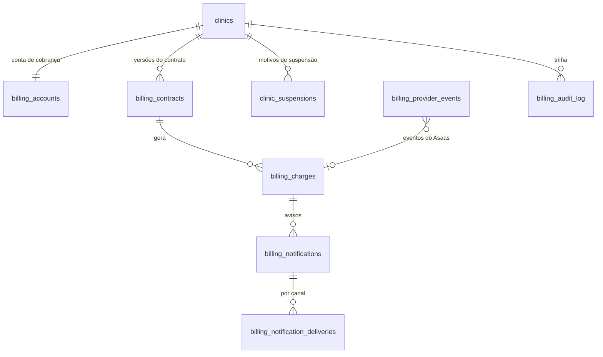
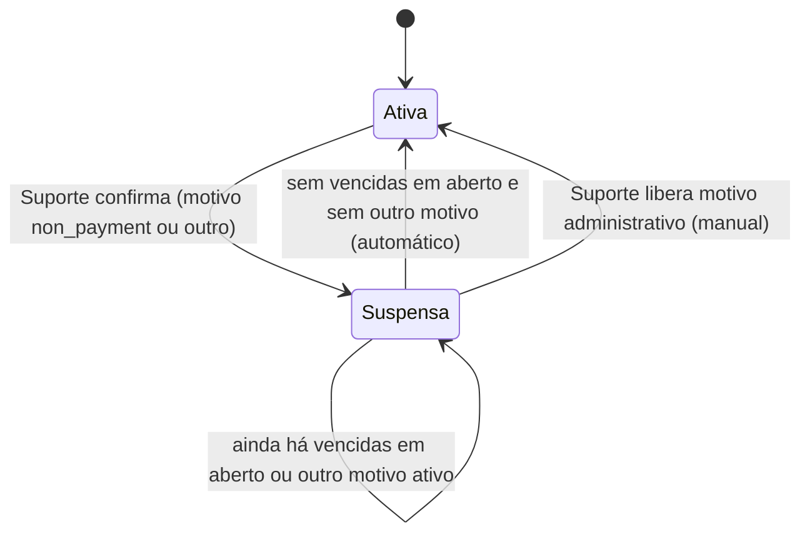

# Faturamento recorrente do SaaS (Asaas)

> **Estado atual (retomar daqui), 02/nov/2026.** Branch **`faturamento`**, local, sem push. F12.1 e F12.2 validadas
> no local. **Cliente valida no fim (02/nov):** seguir as fases sem parar; validar tudo junto no local.
> **F12.2b feita** (`20261117120000_aceite_do_contrato.sql`): aceite do contrato pelo Administrador em Configurações ›
> Assinatura (data, hora, quem, IP, versão do texto); texto **provisório** em `src/lib/billingContractText.ts`; mudança
> com o mesmo texto = aceite tácito, início só 30 dias depois da ativação, e-mail dos novos termos ao financeiro (envio
> ou falha na trilha; reenvio na aba Faturamento). Regra para a F12.4: só cobrar contrato com aceite.
> **F12.2c feita (cliente, 03/nov)** (`20261124120000_contrato_nota_fiscal.sql`): o texto só fala de nota fiscal quando o
> contrato cobra nota (duas versões em `billingContractText.ts`; a com nota termina em `-nf`, o banco confere na
> ativação junto com o Módulo financeiro). Liberou ou desligou o "finance" na Matriz: o sistema monta o **rascunho** da
> nova versão (com o preço por nota padrão, ou sem nota) a partir da vigente; o Suporte confere e ativa; texto diferente
> = a clínica assina na tela. Sem contrato nenhum, nada é criado. **A emissão de nota só sai com contrato em vigor,
> aceito e com preço por nota** (também sem contrato nenhum: os testes da F11 no staging precisam de contrato manual
> aceito). Contrato com texto antigo (fora do código) não se aceita: o Suporte ativa uma nova versão.
> **F12.3 feita** (`20261118120000_suspensao_da_clinica.sql`): `clinic_suspensions` (administrativo e fim do contrato;
> inadimplência recusada até a F12.4, item 28), situação anterior guardada e devolvida, "suspensa" só pelas funções;
> aba Suspensão da clínica (aba própria desde 03/nov, antes um cartão no Faturamento; alerta e confirmação a mais sem o app, item 23). Bloqueio no código: painel
> (Administrador só na Assinatura, outros em `/admin/clinica-suspensa`, API 403), `/agendar`, `/preparo` e
> `/orientacoes` com "indisponível no momento", bot e envios (`createClinicSender` nulo; a mensagem fica no histórico,
> sem aviso à equipe); rotinas já pulavam. `/formulario` e `/importar` (links da clínica com o Suporte) seguem abertos.
> Testes: `tests/db/suspensao.test.ts`, `clinicaEmImplantacao.test.ts`.
> **F12.3b feita** (`20261119120000_suspensao_no_banco.sql`): gatilho `app.guard_suspended_clinic_write` em toda tabela
> com `clinic_id` (fora `app.suspension_free_tables()`: billing_*, clinic_suspensions, registros e push) e na própria
> `clinics`; recusa a gravação de login da clínica (não o Suporte) na clínica suspensa; `clinic_service` e service
> role seguem. **Tabela nova com `clinic_id` precisa do gatilho** (o teste `suspensao-banco` confere). Arquivos do
> Storage (logo) não entram.
> **F12.4 feita** (`20261120120000_cobranca_asaas.sql`; itens 28 e 29): no aceite (modo automático), o servidor cria no
> Asaas o cliente (procura pelo CNPJ/CPF; avisos do Asaas desligados), a assinatura (1º vencimento do contrato, ou hoje
> se já passou) e a implantação **com vencimento no dia do aceite**; espelho em `billing_charges` (paga = CONFIRMED,
> RECEIVED ou RECEIVED_IN_CASH); tudo idempotente pela referência externa. Falha fica no contrato e na trilha; o Suporte
> tem "Tentar de novo"/"Atualizar do Asaas" na aba Faturamento. Assinatura mostra as Cobranças com "Pagar" (fatura do
> Asaas). Inadimplência liberada: o banco exige cobrança do Asaas em aberto no 15º dia de atraso ou depois.
> Variáveis: `ASAAS_API_KEY` e `ASAAS_BASE_URL` (sandbox ou produção); sem elas, a aba avisa "não configurado". Para
> testar no local, copiar as duas do `.env.asaas-sandbox` para o `.env`. **Atenção (03/nov):** a chave começa com
> `$` e o Vite a lê como variável (chega vazia, painel com erro 500): no `.env` escrever `'\$aact…'`. Com a barra,
> o `node --env-file=.env` lê a chave errada; staging e produção não usam o arquivo. Código: `src/lib/asaas/billingApi.ts`,
> `src/lib/data/billingAsaas.ts`, `platformBillingStore` em `platform.ts`. **Ficam para depois:** mudança de versão e
> troca de modo de quem já tem assinatura (pula com aviso); cartão segue pela fatura do Asaas (F12.8).
> **F12.5 feita** (`20261121120000_webhook_asaas.sql`): `POST /api/asaas/webhook` confere `asaas-access-token` em tempo
> constante (`ASAAS_WEBHOOK_TOKEN`, 32+ caracteres), grava em `billing_provider_events` (id único: repetido ignorado),
> responde 200 e processa em segundo plano consultando a cobrança na API (ordem não importa); evento sem contrato nosso
> ou de assinatura = ignorado; falha volta à fila até 10 vezes. Rotinas: `faturamento-eventos` (10 min) e
> `conciliacao-asaas` (6h15 de Brasília: sincroniza todo contrato automático aceito e refaz criação que falhou), as duas
> na `/api/saude`. **Falta, fora do código:** gerar o token, pôr no ambiente e cadastrar o webhook no painel do Asaas
> (fila não sequencial, eventos de cobrança); no local o Asaas não alcança a máquina, então o teste de verdade é no
> staging, quando a branch subir.
> **F12.6 feita** (`20261122120000_reativacao_automatica.sql`): toda cobrança que fica paga tenta reativar, na trava da
> conta de cobrança; libera só a inadimplência e só sem cobrança do Asaas vencida em aberto; sem outro motivo, volta à
> situação de antes; liberado pelo sistema, com o pagamento na trilha. A Assinatura da clínica suspensa por
> inadimplência diz para pagar em Cobranças.
> **F12.7 feita** (`20261123120000_avisos_de_cobranca.sql`): `billing_notifications` (um por cobrança e tipo); rotina
> `avisos-cobranca` às 9h de Brasília agenda o aviso de atraso mais recente que cabe (3º, 7º ou 14º dia; os anteriores
> não saem atrasados) e envia; cobrança paga gera `payment_confirmed` (sai pela `faturamento-eventos`, a cada 10 min) e
> cancela os de atraso pendentes; na hora de enviar confere de novo; falha tenta até 5 vezes; trilha `notice_sent` /
> `notice_failed`. Textos em `billingNoticeEmail` (`src/lib/email.ts`), com a data do 15º dia: **cliente revisa**.
> **F12.8 feita (02/nov):** confirmado no sandbox (cliente e assinatura de teste criados e apagados) que o Asaas aceita
> assinatura `CREDIT_CARD` sem os dados do cartão: a cobrança nasce em aberto, com fatura, onde a clínica informa o
> cartão; pela documentação, os ciclos seguintes são cobrados no mesmo cartão no vencimento (não testado: exige pagar
> a fatura no sandbox, fica para a validação). O RecepClinic não guarda dado de cartão (11.9). A Assinatura orienta a
> clínica no cartão. Troca de cartão: pelo Suporte (a API exige os dados do cartão). Em produção, a **tokenização**
> depende de liberação do Asaas, e mudar valor ou vencimento de assinatura no cartão a exige: pedir antes da F12.11.
> **Próximo: F12.11** (homologação e produção), depois de: advogado (texto do contrato e 11.16), chave e webhook do
> Asaas de produção, valor combinado com a clínica piloto. Antes, validar F12.2b a F12.8 no local/staging.
> **Ordem decidida (cliente, 30/out):** cobrança primeiro, até cobrar a clínica piloto em produção, **só com aviso por
> e-mail**: F12.2b, F12.3, F12.3b, F12.4 a F12.8 e F12.11 (itens 18 a 26 da seção 11). Depois: F12.9 (decisão 11.10),
> F12.10 (Pix Automático) e a nota fiscal pelo Asaas (N0–N6). **Próximo:** validação da F12.2b no local e o OK para a
> F12.3. Antes da F12.11: advogado (11.16 e texto do contrato), chave e webhook do Asaas de produção, avisos do Asaas
> desligados (11.11) e o valor combinado com a clínica piloto.
>
> Decisões já respondidas (28/out): **11.1** (motivos registrados), **modo de cobrança manual** (seção 3) e **11.2**
> (pago = `CONFIRMED` ou `RECEIVED`) **11.3** (bloqueio no painel primeiro, banco depois) **11.4** (bot calado, link com aviso) **11.5** (Assinatura só para o Administrador) **11.6** (estorno marca e avisa o Suporte) **11.7** (novo valor no próximo ciclo, sem proporcional) **11.8** (implantação ao ativar, conta igual) **11.9** (cartão na página do Asaas). **11.10 fica pendente** (número do WhatsApp, decidir antes da F12.9).
> **11.11** (avisos do Asaas desligados, só os nossos) e **11.12** (cancelamento: cobra o devido, acesso até o
> fim do período pago) **11.13** (dias corridos, 9h de Brasília) **11.14** (nota fiscal fora do sistema) **11.15** (sem IP fixo por agora) **11.17** (troca de modo por nova versão do contrato) e **publicação pelo endereço de
> teste da branch**. Faltam: 11.10 (número do WhatsApp, antes da F12.9) e 11.16 (jurídico, antes da F12.11).

## Como trabalhar nesta etapa

- **Planejamento na `main`** (cliente, 30/out): a branch `faturamento` (criada em 28/out, só com documentos) entrou na
  `main` e foi excluída. Ela é **recriada da `main` só quando o código começar** (F12.1 ou N1), e segue as regras de
  branch paralela do `CLAUDE.md`.
- **Ajuda contextual (cliente, 30/out):** cada fase entra com a ajuda das próprias telas ("i" nos campos e "Como
  funciona?", padrão de [`ajuda-contextual.md`](ajuda-contextual.md); textos em `src/lib/ajuda/`). A F12.1 já entrou com
  a da tela Assinatura (WhatsApp financeiro e telefone financeiro).
- **Parar e voltar à `main`:** commit e push do que estiver em andamento na `faturamento`, atualizar o bloco "Estado
  atual" deste arquivo e `git switch main`.
- **Publicação (cliente, 28/out):** cada fase vai para o **endereço de teste da branch** na Vercel (Preview da
  `faturamento`), usando o banco do staging; as migrações do faturamento só acrescentam e não afetam o `teste.`. A
  `main` segue indo à produção sem o faturamento; só com o conjunto validado pelo cliente a `faturamento` entra na
  `main` e segue o fluxo normal de `producao.md`. Nada vai a ambiente nenhum sem o OK do cliente.
- **Cuidado com o banco do staging:** com migrações da `faturamento` aplicadas nele, um `supabase db push` feito da
  `main` (correção urgente com migração) acusa versões remotas que a `main` não tem. Nesse caso, aplicar a migração da
  correção pelo SQL Editor e registrar a versão (`supabase_migrations.schema_migrations`), como na parte de migrações
  de `staging.md`, ou trazer a correção para a `faturamento` antes. A produção não é afetada.

Marcas: **[Código]** conferido no repositório; **[Projeto]** registrado na documentação do projeto;
**[Asaas]**, **[Meta]**, **[Vercel]** documentação oficial (fontes no fim); **[Inferência]** conclusão técnica;
**[Recomendação]** proposta, aprovada só quando a decisão correspondente for respondida.

O faturamento do SaaS (o RecepClinic cobrando as clínicas) é diferente do **Financeiro F11** (a clínica recebendo dos
pacientes, com `payments` e NFS-e). Nomes com prefixo `billing_` para não colidir.

## 1. Resumo

- Módulo da plataforma (Suporte), no padrão de isolamento existente: `clinic_id`, RLS e gravação só por funções do
  banco.
- Suspensão por **motivos** registrados; `clinics.status = 'suspended'` é consequência. A reativação automática
  libera só o motivo "inadimplência".
- **[Código]** Hoje a situação "suspensa" quase não tem efeito (seção 2). Bloquear exige mexer no painel, nas páginas
  públicas, no bot, nas rotinas e nos envios.
- **[Asaas]** Webhooks "pelo menos uma vez" com `id` do evento; token no cabeçalho `asaas-access-token` (sem
  assinatura); fila interrompida após 15 falhas seguidas; eventos guardados por 14 dias. Conciliação por rotina é
  obrigatória.
- **[Inferência]** Pix Automático: o Asaas exige CNPJ ativo há 6 meses ou mais; o CNPJ do RecepClinic foi aberto em
  10/out/2026 **[Projeto]**, então a elegibilidade deve vir só por volta de abril/2027. Confirmar com o Asaas.
- **[Inferência]** WhatsApp financeiro exige conta (WABA) e número **do próprio RecepClinic**: a infraestrutura atual
  envia pelo número de cada clínica aos pacientes.

## 2. Arquitetura atual validada (28/out/2026)

| Tema | Conclusão | Onde |
|---|---|---|
| Stack | Astro 7 (servidor), TypeScript, Supabase, Vercel `gru1`, CI no GitHub Actions | `package.json`, `astro.config.mjs`, `vercel.json`, `.github/workflows/ci.yml` |
| Multi-clínica | `clinic_id` em cada linha, RLS por clínica (D1) | `supabase/migrations/20261004120000_nucleo.sql` |
| Papéis | `clinic_members.roles` (`admin`, `professional`, `reception`); Suporte em `platform_staff`; `app.is_clinic_member`, `app.has_clinic_role`, `app.is_platform_staff` | `nucleo.sql` |
| Painel | Middleware confere login, monta o `ClinicContext` (com `clinicStatus`), confere a rota e registra as leituras do Suporte | `src/middleware.ts`, `src/lib/clinicAccess.ts`, `src/lib/data/clinicContext.ts` |
| Situação da clínica | `active`, `suspended`, `onboarding`; só o Suporte muda (`app.guard_clinic_status`); `setClinicStatus` aceita só `active`/`onboarding` | `20261025140000_clinica_em_implantacao.sql`, `src/lib/data/onboarding.ts` |
| Credenciais | Login (`createUserClient`); credencial da clínica (`createClinicServiceClient`, papel `clinic_service`); service role só em `platform.ts` | `src/lib/data/clients.ts`, `clinicService.ts`, `platform.ts` |
| Rotinas | `pg_cron` → `app.call_system_route` → `/api/cron/*` com `Bearer CRON_SECRET`; `cronRoute()` por clínica, com heartbeat | `20261007170000_envios_automaticos.sql`, `src/lib/cron/route.ts`, `cron_heartbeats`, `/api/saude` |
| Webhook da Meta | HMAC com `timingSafeEqual`, 200 rápido, repetidos ignorados por `wa_message_id` | `src/pages/api/whatsapp/webhook.ts`, `src/lib/data/whatsapp/webhook.ts` |
| Integração externa com estado | NFS-e: `issuing` → `issued`/`rejected`, "uma ativa por pagamento", conferência por rotina, trilha só de inclusão | `20261012160000_emissao_nfse.sql`, `src/pages/api/cron/notas-fiscais.ts` |
| Auditoria | `platform_audit_log` (gravações do Suporte), `platform_access_log` (leituras), `fiscal_audit_log` | `nucleo.sql`, `20261004190000`, `20261012140000` |
| E-mail | SMTP (`smtpSender`, `EMAIL_FROM`); sem histórico genérico de envios | `src/lib/email.ts` |
| Avisos no painel | Faixa do `AdminLayout.astro`, avisos do Início, `push_subscriptions` | `src/layouts/AdminLayout.astro`, `20261027160000_notificacoes.sql` |
| WhatsApp | Por clínica: `whatsapp_connections` (token no Vault), `whatsapp_templates` e `whatsapp_messages` por `clinic_id`; o webhook resolve a clínica pelo `phone_number_id` | `20261004170000_whatsapp_e_rotinas.sql`, `src/lib/data/whatsapp/send.ts` |
| Planos | Tabela comercial no código, plano deduzido da matriz; nada gravado por clínica | `src/lib/plans.ts`, `src/components/admin/vendas/PlanosTab.astro` |
| Erros | `src/lib/log.ts` (sem dado pessoal) → `system_errors` → Better Stack via `/api/saude` | `20261009130000_erros_e_saude.sql` |

**[Código] Onde a situação "suspensa" é respeitada hoje:**

| Ponto | Clínica `suspended` |
|---|---|
| Painel (`src/middleware.ts`) | não barra |
| Páginas públicas (`/agendar`, `/formulario`, `/importar`, `/preparo`, `/orientacoes`) | não conferem |
| Bot e envios do painel (`createClinicSender`) | barra só `onboarding` |
| Rotinas com `list_active_clinics` (lembretes, resumo, lista de espera, reenvios, atendimento humano) | pulam (`status = 'active'`) |
| Rotina `series` (`list_clinics_in_service`) | pula (`status <> 'suspended'`) |
| `conversas-paradas`, `notas-fiscais` | listas próprias; conferir na implementação |
| RLS | não considera a situação |

**[Projeto]** Meta: Análise do App e Verificação do acesso aprovadas; RecepClinic Tech Provider desde 24/out
(`docs/README.md`). Não conferido na Meta.

## 3. Decisões de negócio já tomadas (cliente, 28/out/2026)

- **Modo de cobrança por clínica (cliente, 28/out):** **automático** (Asaas, avisos, atraso e reativação, como abaixo)
  ou **manual**: o Suporte marca que a clínica não entra na cobrança automática e cobra por fora. No manual o sistema
  guarda o contrato e os **pagamentos registrados à mão pelo Suporte** (histórico), mas a clínica **nunca consta em
  atraso**: sem cobrança no Asaas, sem avisos de atraso, sem reativação automática. Suspensão, se houver, é manual
  (com motivo) e liberada pelo Suporte. A marcação do modo registra quem e quando.

- **Cobrança por nota fiscal emitida (cliente, 29/out):** a NFS-e das clínicas passa a sair pelo Asaas (subconta por
  clínica, [`planejamento-nfse-asaas.md`](planejamento-nfse-asaas.md)); o RecepClinic paga a tarifa do Asaas e cobra da
  clínica um **preço por nota** (padrão do Suporte, copiado para o contrato e negociável), com **franquia mensal** no
  contrato (ou ilimitada; sem acumular). Contam as notas autorizadas no mês, inclusive as canceladas depois. As
  excedentes de um mês são cobradas no mês seguinte numa **cobrança avulsa separada**, com o mesmo vencimento da
  mensalidade (a assinatura não muda; cliente, 29/out, recomendação do Asaas), com o detalhamento na tela Assinatura (Administrador da
  clínica). No modo manual, o Suporte cobra pelo mesmo detalhamento.

- Provedor Asaas; cartão, Pix Automático e Pix convencional.
- Valor mensal negociado e gravado por contrato; implantação avulsa, quando houver; preço de referência não muda
  contrato.
- Sem suspensão automática: suspensão manual do Suporte, com confirmação, responsável, data e motivo.
- Na suspensão: bloquear operação e automações; preservar o acesso administrativo para regularizar, o do Suporte e os
  dados.
- Avisos D+3 (atraso), D+7 (o Suporte pode avaliar a suspensão) e de pagamento reconhecido; idempotentes; os que
  ficarem indevidos são cancelados.
- Reativação automática só com **todas** as cobranças vencidas regularizadas, preservando outros motivos de suspensão.
- Estado local sincronizado; nada de consultar o Asaas a cada requisição.
- E-mail financeiro obrigatório; telefone financeiro e opção explícita de WhatsApp. Falha do WhatsApp não impede o
  e-mail; resultado de cada canal registrado.

## 4. Modelo de domínio (conceitual)



| Conceito | Nome proposto | Conteúdo essencial | Por quê |
|---|---|---|---|
| Conta de cobrança (1 por clínica) | `billing_accounts` | Razão social/nome e CNPJ/CPF do pagador, e-mail financeiro (obrigatório), telefone financeiro, opt-in de WhatsApp (quando, por quem), `asaas_customer_id` (único), ambiente | Separada de `clinic_fiscal_settings` (emissor da NFS-e, só com o F11) e dos contatos de pacientes; fora da linha `clinics`, que o Administrador da clínica pode alterar |
| Contrato | `billing_contracts` | **Modo de cobrança (`asaas` ou `manual`)**, valor mensal, **preço por nota (`invoice_unit_price_cents`) e franquia mensal (`invoice_monthly_allowance`, nulo = ilimitada)** (29/out), implantação (valor ou isenção), 1º vencimento, forma de pagamento, retrato do plano de referência (informativo), vigência, situação (`draft`, `active`, `ended`, `canceled`), `asaas_subscription_id`, `pix_automatic_authorization_id` | Mudança comercial = nova versão (`replaces_contract_id`) com data de início |
| Cobrança | `billing_charges` | Origem (`asaas` ou `manual`), `asaas_payment_id` (único, só no Asaas), tipo (`monthly`, `setup`, `other`), vencimento, valor, forma, situação local e a bruta do Asaas, `paid_at`, link da fatura, `last_synced_at`; no manual, quem registrou e quando | Espelho do Asaas e histórico dos pagamentos manuais num lugar só; atraso, avisos e reativação só olham a origem `asaas` |
| Item da cobrança (29/out) | `billing_charge_items` | Cobrança, tipo (`monthly`, `setup`, `invoice_overage`, `other`), quantidade, preço unitário, total | Detalhamento da fatura para a clínica |
| Apuração das notas (29/out) | `billing_invoice_usage` | Clínica, mês, notas autorizadas (lidas de `nfse_invoices`), franquia, excedentes, preço, valor, cobrança em que entrou; fechada no 1º dia do mês seguinte | Fatura do mês seguinte; o mês aberto é calculado ao vivo |
| Preço padrão por nota (29/out) | `billing_settings` (uma linha) | Preço padrão em centavos, quem mudou e quando | Parâmetro do Suporte, copiado para os contratos novos |
| Evento recebido | `billing_provider_events` | `provider_event_id` (único), tipo, recurso, dados mínimos, recebido/processado em, situação, tentativas, erro | Idempotência e reprocessamento |
| Aviso | `billing_notifications` | Cobrança, tipo (`overdue_d3`, `overdue_d7`, `payment_confirmed`), programado para, situação; único por (cobrança, tipo) | Sem duplicidade; cancela os indevidos |
| Envio por canal | `billing_notification_deliveries` | Canal (`email`, `whatsapp`), tentativas, id no provedor, erro, enviado em | Um canal não trava o outro |
| Motivo de suspensão | `clinic_suspensions` (decisão 11.1; fora do prefixo `billing_` porque nem todo motivo é financeiro) | Motivo (`non_payment`, `administrative`, `contract_ended`), texto, criado por/em; liberado em/por (nulo = sistema), motivo da liberação | Distingue inadimplência de outros motivos |
| Trilha | `billing_audit_log` (só inclusão) | Ator (pessoa, sistema, webhook), ação, antes/depois, motivo | O `platform_audit_log` só pega o Suporte |

Sem duplicar: `clinic_usage_monthly` (uso), `plans.ts` (referência), `clinics.status` (sinal das rotinas),
`system_errors`, `cron_heartbeats`.

## 5. Integração com o Asaas

**Fatos [Asaas]:**

- API: cabeçalho `access_token`; `api-sandbox.asaas.com/v3` e `api.asaas.com/v3`; contas e chaves separadas por
  ambiente; chave expira de vez após 6 meses sem uso; restrição por IP disponível.
- Assinaturas: o Asaas gera as cobranças futuras uma a uma; criar a assinatura não confirma pagamento; cada cobrança
  traz `subscription`. Cartão validado na criação, ciclos seguintes podem falhar; tokenização precisa ser liberada na
  produção.
- Pix Automático: autorização (`POST /v3/pix/automatic/authorizations`) com QR Code do 1º pagamento e consentimento;
  `ACTIVE` após o 1º pagamento e a confirmação do banco do pagador; modo `SUBSCRIPTION` (o Asaas gera) ou `MANUAL`
  (instrução entre 2 e 10 dias úteis antes do vencimento); retentativa no mesmo dia pelo banco do pagador e, com
  `retryPolicy = ALLOW_THREE_IN_SEVEN_DAYS`, até três em sete dias; elegibilidade: conta PJ aprovada, sem pendências,
  CNPJ ativo há 6 meses ou mais, sem restrição de Pix (evento `PIX_AUTOMATIC_RECURRING_ELIGIBILITY_UPDATED`).
- Webhooks: "pelo menos uma vez" com `id`; token `asaas-access-token` (não usar a chave da API); persistir, responder 200
  e processar depois; fila `SEQUENTIALLY` ou `NON_SEQUENTIALLY`; interrompida após 15 falhas; eventos por 14 dias; IPs
  oficiais publicados (mudam).
- Eventos de cobrança: `PAYMENT_CREATED`, `PAYMENT_UPDATED`, `PAYMENT_CONFIRMED` (pago, saldo ainda indisponível),
  `PAYMENT_RECEIVED` (saldo disponível), `PAYMENT_OVERDUE`, `PAYMENT_DELETED`, `PAYMENT_RESTORED`,
  `PAYMENT_AWAITING_RISK_ANALYSIS` e aprovado/reprovado, `PAYMENT_CREDIT_CARD_CAPTURE_REFUSED`, `PAYMENT_REFUNDED`,
  `PAYMENT_PARTIALLY_REFUNDED`, `PAYMENT_REFUND_IN_PROGRESS`, `PAYMENT_CHARGEBACK_REQUESTED`, `…_DISPUTE`,
  `PAYMENT_AWAITING_CHARGEBACK_REVERSAL`. Cartão: CONFIRMED e, cerca de 32 dias depois, RECEIVED; Pix: RECEIVED.
- Assinatura: `SUBSCRIPTION_CREATED`, `SUBSCRIPTION_UPDATED`, `SUBSCRIPTION_INACTIVATED`, `SUBSCRIPTION_DELETED`.
- Pedidos: timeout mínimo de 60 s; não repetir sem conferir a resposta anterior.

**[Recomendação]**

1. Cliente criado pelo Suporte ao ativar a conta de cobrança; guardar `asaas_customer_id`; referência externa = id da
   clínica (nome do campo a confirmar); procurar pelo CNPJ/CPF antes de criar.
2. Cartão e Pix convencional por **assinatura** do Asaas; Pix Automático por autorização em modo `SUBSCRIPTION`;
   implantação e notas excedentes por cobrança avulsa (`POST /v3/payments`).
3. Cartão sem dado de cartão no RecepClinic: página de fatura do Asaas (a confirmar na referência).
4. Webhook: rota pública fora de `/admin`; token em tempo constante (e IPs oficiais, se aprovado); grava em
   `billing_provider_events` com `on conflict do nothing`; responde 200; processa com `waitUntil` e rotina de
   recuperação; **consulta a cobrança na API antes de dar como paga**; fila `NON_SEQUENTIALLY`, regras que não dependem
   da ordem.
5. Conciliação diária e de recuperação: cobranças não finais ou recentes conferidas na API; listagem dos últimos N dias
   por cliente para achar o que não chegou; divergências na trilha e na tela do Suporte.
6. Credenciais da plataforma em variáveis de ambiente por ambiente (ex.: `ASAAS_API_KEY`, `ASAAS_WEBHOOK_TOKEN`,
   `ASAAS_ENV`); processamento por funções estreitas com service role em `platform.ts` chamando funções security
   definer liberadas só à `service_role`; `clinic_service` sem acesso ao faturamento.
7. Indisponibilidade: nada do painel depende do Asaas em tempo real; webhook parado coberto pela conciliação;
   heartbeat próprio na `/api/saude`.

## 6. Fluxos

```mermaid
sequenceDiagram
  participant A as Asaas
  participant W as Webhook (rota pública)
  participant DB as Supabase
  participant P as Processador (waitUntil + rotina)
  A->>W: POST evento (asaas-access-token)
  W->>W: confere token (tempo constante) e IP
  W->>DB: insere billing_provider_events (id único; repetido = ignora)
  W-->>A: 200
  P->>DB: pega eventos pendentes (trava por linha)
  P->>A: GET /payments/{id} (estado real)
  P->>DB: atualiza billing_charges + trilha (função security definer)
  P->>DB: cancela avisos indevidos; tenta reativar a clínica
```



0. **Modo manual:** o Suporte marca o contrato como `manual`; não cria cliente nem assinatura no Asaas; registra cada
   pagamento recebido (valor, data, forma, observação), que fica no histórico; nenhuma rotina de atraso ou aviso olha
   essa clínica; suspensão e liberação só pelo Suporte.
1. **Contratação:** o Suporte abre "Faturamento" na clínica, preenche a conta de cobrança (ou o Administrador da
   clínica, os contatos) e o contrato em rascunho; ao ativar, cria ou associa o cliente no Asaas; tudo na trilha.
2. **Preço negociado:** fixo no contrato; mudança = nova versão com data de início (decisão 11.7).
3. **Implantação:** cobrança avulsa `setup`, se não isenta (decisão 11.8).
4. **Assinatura:** criada com valor, forma e 1º vencimento; cobranças entram no espelho por `PAYMENT_CREATED` e pela
   conciliação.
5. **Pagamento:** evento → consulta na API → cobrança paga (decisão 11.2) → aviso de reconhecido → tentativa de
   reativação.
6. **Avisos de atraso:** rotina diária cria `overdue_d3` e `overdue_d7` (únicos); na hora de enviar, confere de novo e
   cancela se pago; e-mail sempre e WhatsApp com opt-in, cada canal registrado; aviso atrasado sai uma vez só.
7. **Suspensão manual:** o Suporte vê as vencidas e confirma "Suspender por inadimplência" com motivo; a função do
   banco trava a clínica, grava o motivo `non_payment`, põe `clinics.status = 'suspended'` (guardando a situação
   anterior) e registra.
8. **Acesso na suspensão:** Administrador da clínica só na tela "Assinatura"; outros papéis com aviso; Suporte com
   acesso total registrado; páginas públicas e bot indisponíveis (decisão 11.4); rotinas já pulam; dados preservados.
9. **Regularização:** cada pagamento atualiza a cobrança; continua suspensa enquanto houver qualquer vencida em aberto.
10. **Reativação automática:** na mesma trava; sem vencidas em aberto, libera `non_payment` (pelo sistema, com o
    pagamento que fechou a conta); sem outro motivo ativo, volta à situação anterior.
11. **Falha de webhook:** conciliação corrige o espelho e segue o fluxo 5; fila parada vira alerta.
12. **Cancelamento:** o Suporte encerra o contrato e cancela a assinatura no Asaas (decisão 11.12).
13. **Duplicado, estorno, chargeback:** duplicado sinalizado ao Suporte, que estorna; `PAYMENT_REFUNDED` e
    `PAYMENT_CHARGEBACK_*` marcam a cobrança como revertida, sem suspensão automática (decisão 11.6); estorno parcial
    sinalizado.
14. **E-mail ou WhatsApp fora do ar:** retentativa com limite por canal; um não bloqueia o outro; sem nenhum, aviso
    `failed` visível ao Suporte e a faixa do painel continua.

## 7. Segurança, consistência e LGPD

- RLS em todas as `billing_*`; leitura do Suporte e do Administrador da própria clínica (o necessário); gravação pela
  API revogada; mudanças só por funções com `app.is_platform_staff()` ou pela `service_role`; `revoke` explícito de
  `clinic_service`, `anon` e `authenticated` (o `nucleo.sql` dá permissão padrão em tabela nova).
- Valores e situação fora da linha `clinics`, salvo `clinics.status`, já protegida por `guard_clinic_status`.
- Telas do Suporte em `/admin/sistema/*` (middleware já restringe) e conferência de novo no banco.
- Webhook: token em tempo constante, IPs oficiais (opcional), consulta na API antes de efeitos de pagamento, limite de
  tamanho do corpo. Aproveitar para trocar o `!==` do `CRON_SECRET` por comparação em tempo constante.
- Idempotência: id único do evento; aviso único por (cobrança, tipo); cobrança única por `asaas_payment_id`; criação no
  Asaas com referência externa e consulta antes de repetir.
- Concorrência: suspender, confirmar pagamento e reativar usam a mesma trava (`select … for update` na conta de
  cobrança), como `check_professional_limit`; pagamentos simultâneos ficam em série; suspender recalcula na hora.
- Motivos independentes: a reativação automática só libera `non_payment`.
- Trilha `billing_audit_log` só de inclusão, mais o `platform_audit_log`.
- LGPD: Asaas como operador; opt-in do WhatsApp com o nome do RecepClinic e a finalidade **[Meta]**; prazo de guarda
  dos dados financeiros; dados de pacientes fora do faturamento. Validação jurídica: termo de tratamento, contrato,
  política de privacidade.

## 8. Interface administrativa (proposta)

- **Suporte:** aba "Faturamento" em `src/pages/admin/sistema/clinicas/[id].astro`: contrato e versões, conta de
  cobrança e contatos, situação financeira, cobranças com o estado do Asaas e "Sincronizar agora", avisos e envios por
  canal, "Suspender por inadimplência" (confirmação e motivo), "Liberar motivo administrativo", trilha, divergências.
  Na visão geral: clínicas com vencidas e saúde do webhook.
- **Administrador da clínica:** tela "Assinatura": valor contratado, próximas e vencidas com o link de pagamento,
  contatos financeiros e opt-in (com trilha). **Notas fiscais (29/out):** preço por nota, franquia, notas do mês até agora
  (incluídas, excedentes, valor previsto), histórico por mês e a lista das notas que entraram (sem CPF). Na suspensão, é a única tela liberada, com a faixa explicando.

## 9. Testes e implantação

- **Unidade:** mapa de estados do Asaas, regra "sem vencidas em aberto", D+3/D+7, escolha de canais, conferência do
  token.
- **Banco (`tests/db`):** RLS por clínica; Administrador sem mudar valor ou situação; `clinic_service` sem acesso;
  suspender/liberar/reativar; concorrência (dois pagamentos, pagamento contra suspensão); motivos diferentes; aviso
  único; cancelamento de aviso indevido.
- **Webhook:** repetido, atrasado, fora de ordem, token errado, malformado; API divergente do evento; fila parada
  recuperada pela conciliação.
- **Rotinas:** falha no meio e nova execução sem duplicar; e-mail fora; WhatsApp fora.
- **Regressão:** ativa e em implantação sem mudança; suspensa bloqueada no painel, páginas públicas, bot e rotinas,
  Assinatura e Suporte liberados; `npm test`, `npm run test:db`, `astro check`.
- **Sandbox do Asaas** (conta própria; e-mails e SMS do sandbox saem de verdade): cliente, assinatura Pix, implantação,
  confirmação simulada, webhook no staging, estorno; cartão e Pix Automático conforme o sandbox permitir.
- **Homologação no staging:** uma clínica de teste no ciclo completo (vence, D+3, D+7, suspende, paga, reativa) e outra
  com motivo administrativo que não reativa sozinha.
- **Produção:** testes passando, ciclo validado pelo cliente, chave e webhook da produção configurados pelo cliente,
  termo jurídico revisado, plano de volta escrito.
- **Volta:** reverter o commit da `producao`; migrações só de inclusão e `cron.unschedule` das rotinas novas sem apagar
  dados; liberar os motivos pelo Suporte; desativar o webhook no Asaas.

## 10. Riscos, dependências e limitações

- Pix Automático depende da elegibilidade (CNPJ com 6 meses, conta PJ aprovada) **[Asaas]**: lançar sem ele.
- WhatsApp financeiro exige WABA e número do RecepClinic, templates de utilidade aprovados, opt-in e histórico próprio;
  o webhook atual não reconhece número da plataforma (`resolveClinicByPhoneNumberId` devolve nulo, vira
  `unknownNumbers`) **[Código]**; a Meta pode reclassificar utilidade como marketing **[Meta]**. Não reaproveitar o
  `+55 61 9903-3143` (clínica de testes do staging) nem o número do app antigo sem avaliar.
- Restrição da chave por IP: a Vercel sai por IP variável; IP fixo = "Static IPs", US$ 100/mês por projeto no Pro
  **[Vercel]**.
- Bloqueio só no código: com o login, a pessoa pode chamar a API do Supabase direto (decisão 11.3).
- O Asaas pode avisar o cliente por conta própria e duplicar os avisos; opção de desligar a confirmar.
- Limitações: referência completa das APIs não lida (`externalReference`, mudança de valor de assinatura, página de
  fatura, `notificationDisabled`); banco da produção não consultado.

## 11. Decisões pendentes (uma de cada vez, com recomendação)

1. **Modelo da suspensão.** **Decidido (cliente, 28/out):** motivos registrados (`clinic_suspensions`: inadimplência ou
   administrativo, com quem, quando e texto); a clínica fica suspensa enquanto houver algum motivo ativo; o pagamento
   libera só o de inadimplência; `clinics.status = 'suspended'` continua sendo o sinal para o resto do sistema.
2. **O que conta como pago** para reativar e avisar. **Decidido (cliente, 28/out):** `CONFIRMED` ou `RECEIVED`
   (também o recebimento em dinheiro registrado no Asaas, se houver); análise de risco não conta.
3. **Onde fica o bloqueio.** **Decidido (cliente, 28/out):** primeiro no código (painel, páginas públicas, bot,
   rotinas e envios), na F12.3; depois, numa fase própria (F12.3b), o banco também recusa gravações operacionais da
   clínica suspensa, com testes próprios.
4. **O que o paciente vê na suspensão.** **Decidido (cliente, 28/out):** o bot não responde (a mensagem chega no app
   do WhatsApp da clínica); os links públicos mostram "Agendamento indisponível no momento. Fale com a clínica.";
   nada fala de cobrança ou suspensão para o paciente.
5. **Quem vê a tela Assinatura.** **Decidido (cliente, 28/out):** só o Administrador da clínica; Recepção e
   Profissional não veem e, na suspensão, veem só "Clínica suspensa: fale com o Administrador".
6. **Estorno ou chargeback depois do pagamento.** **Decidido (cliente, 28/out):** a cobrança fica marcada como
   revertida e em destaque para o Suporte, que decide; nada muda sozinho no acesso e não sai aviso automático para a
   clínica.
7. **Mudança de valor no meio do ciclo.** **Decidido (cliente, 28/out):** vale a partir do próximo ciclo, sem
   proporcional; a cobrança já gerada não muda; o Suporte registra a nova versão do contrato com a data de início.
8. **Implantação.** **Decidido (cliente, 28/out):** a cobrança avulsa é gerada quando o Suporte ativa o contrato,
   com o vencimento que ele informar; vencida, segue as regras da mensalidade (avisos D+3 e D+7, pesa na suspensão,
   precisa estar paga para reativar).
9. **Captura do cartão.** **Decidido (cliente, 28/out):** na página de pagamento do Asaas (link na tela Assinatura e
   no e-mail); nenhum dado de cartão no RecepClinic. Confirmar na referência do Asaas como a página trata a
   assinatura no cartão nos ciclos seguintes.
10. **Número de WhatsApp do RecepClinic.** **Pendente a pedido do cliente (28/out), decidir antes da implementação da
    F12.9.** Precisa ser um número do RecepClinic (não o da clínica, que fala com os pacientes). Opções levantadas:
    o número do RecepClinic hoje usado nos testes (tiraria dos testes), o número pessoal do cliente (em coexistência;
    o nome exibido vira "RecepClinic" para todos os contatos, as respostas das clínicas caem nas conversas pessoais e
    o número fica ligado à conta do RecepClinic na Meta) ou um chip dedicado (recomendado). Junto, decidir se a
    cobrança entra no ar só com e-mail até o WhatsApp estar aprovado (recomendado).
11. **Avisos do próprio Asaas.** **Decidido (cliente, 28/out):** desligar os avisos do Asaas ao pagador; a clínica
    recebe só os do RecepClinic. Confirmar na referência do Asaas se e como dá para desligar; se não der, voltar ao
    cliente antes da F12.7.
12. **Cancelamento do contrato.** **Decidido (cliente, 28/out):** a assinatura no Asaas é cancelada e as mensalidades
    futuras deixam de ser geradas; as já vencidas continuam em aberto para cobrar; a clínica usa até o fim do período
    já pago e então fica suspensa com o motivo `contract_ended` (liberado só pelo Suporte); dados preservados para
    exportação ou devolução conforme o contrato (prazo e forma com o advogado, item 16).
13. **D+3 e D+7.** **Decidido (cliente, 28/out):** dias corridos a partir do vencimento, envio às 9h de Brasília,
    também em fim de semana e feriado (vence dia 10: aviso dia 13, alerta dia 17).
14. **Nota fiscal das mensalidades.** **Decidido (cliente, 28/out):** fora do sistema (o contador emite); o
    faturamento não trata nota fiscal e a emissão automática do Asaas fica desligada.
15. **IP fixo na Vercel.** **Decidido (cliente, 28/out):** não por agora; a chave fica só nas variáveis da Vercel
    (nunca no código ou nos registros), com troca periódica; reavaliar quando houver mais clínicas pagando.
16. **Jurídico (respondido pelo advogado em 30/out, item 18):** Asaas como operador, texto do opt-in, prazo
    de guarda e forma de devolução ou exportação dos dados no fim do contrato.
17. **Troca de modo.** **Decidido (cliente, 28/out):** só por nova versão do contrato, com data de início; para o
    automático, cria a assinatura no Asaas a partir dessa data; para o manual, cancela a assinatura e as cobranças em
    aberto no Asaas (com trilha) e o Suporte passa a cobrar por fora.

18. **Parecer do advogado (30/out/2026; [documento](https://claude.ai/artifact/8zajhx22J5AGXDyqEn64F7)).** Confirmados: papéis
    (clínica controladora dos pacientes; RecepClinic operador deles e controlador dos dados de cobrança; Asaas
    suboperador só da cobrança), cancelamento sem multa com acesso até o fim do período pago, guarda de 5 anos dos
    dados financeiros e da trilha, opt-in do WhatsApp livre (e-mail continua obrigatório). Para a F12.9: mensagem
    identificada ("Mensagem oficial do RecepClinic") e saída imediata por "SAIR". Política de privacidade (no site):
    seção de suboperadores com o Asaas. Decisões do cliente sobre o parecer: itens 19 a 26.
19. **Juros e multa.** **Decidido (cliente, 30/out):** multa de 2% e juros de 1% ao mês, configurados na cobrança do
    Asaas (F12.4); sem correção monetária. No modo manual, o Suporte decide.
20. **Prazo da suspensão.** **Decidido (cliente, 30/out; muda o fluxo 7):** a suspensão por inadimplência só pode ser
    feita a partir do **15º dia** de atraso (o banco recusa antes); os avisos informam a data a partir da qual a
    clínica pode ser suspensa.
22. **Avisos de atraso.** **Decidido (cliente, 30/out; muda D+3/D+7):** e-mail no **3º, 7º e 14º dia** de atraso
    (`overdue_d3`, `overdue_d7`, `overdue_d14`); o do 14º diz que a clínica pode ser suspensa a partir do dia seguinte.
23. **Clínica sem o app WhatsApp Business** (número só no sistema). **Decidido (cliente, 30/out):** na suspensão
    ninguém recebe as mensagens dos pacientes; a tela de suspender mostra um alerta forte e pede uma confirmação a
    mais. Com o app (coexistência), o app segue normal e a recepção responde; só o bot e os envios automáticos param.
21. **Clínicas em atraso para o Suporte (cliente, 30/out):** o Suporte consulta numa lista todas as clínicas com
    cobrança vencida (dias de atraso, valor, avisos enviados, situação), além da aba de cada clínica.

24. **Aceite do contrato.** **Decidido (cliente, 30/out):** o 1º contrato é aceito pelo Administrador da clínica em
    Configurações › Assinatura (caixa de aceite; data, hora, IP e versão do texto registrados); a cobrança só começa
    depois do aceite. Mudança de valor: ao ativar a nova versão, e-mail ao financeiro com os novos termos; a nova
    versão só pode começar **30 dias** depois da ativação; o uso continuado vale como aceite. O texto do contrato vem
    do advogado (versionado no sistema). Fase **F12.2b**.
25. **Preço por nota.** **Decidido (cliente, 30/out):** vale o do contrato (como na F12.2); a cláusula do advogado
    troca "tabela vigente" por "preço previsto no contrato".
26. **Fim do contrato.** **Decidido (cliente, 30/out):** dados da clínica disponíveis para exportação por **60 dias**,
    depois exclusão ou anonimização (dados financeiros da cobrança: 5 anos). Fase **F12.12**, depois do lançamento.

27. **Nota fiscal no contrato só quando liberada.** **Decidido (cliente, 30/out):** preço por nota e franquia só
    entram no contrato da clínica com a emissão de nota fiscal liberada (item "finance" da matriz); sem ela, o
    contrato não fala de nota (colunas nulas, o banco confere). Liberada depois, cobrar exige nova versão do contrato.

28. **Inadimplência antes das cobranças.** **Decidido (cliente, 02/nov):** a F12.3 entrega os motivos administrativo e
    fim do contrato e todo o bloqueio; o motivo inadimplência fica pronto no banco, mas é recusado até a F12.4, quando o
    banco passa a conferir a cobrança vencida há 15 dias ou mais (modo automático). No modo manual, decidir depois.

29. **Quando a cobrança nasce no Asaas.** **Decidido (cliente, 02/nov):** no aceite do contrato, sozinha: o sistema cria
    o cliente, a assinatura (a partir do 1º vencimento do contrato) e a cobrança da implantação; falha fica na aba
    Faturamento com "Tentar de novo". **A implantação é cobrada na hora: vence no dia do aceite** (substitui o
    "vencimento que o Suporte informar" da decisão 11.8).

## 12. Roadmap

Cada fase vai ao staging e depende da validação do cliente.

**Ordem revista (cliente, 30/out/2026):** a cobrança vem antes da nota fiscal. Até a produção (cobrar a clínica
piloto): F12.2b, F12.3, F12.3b, F12.4, F12.5, F12.6, F12.7, F12.8 e F12.11, **só com aviso por e-mail**. Depois:
F12.12, F12.9, F12.10 e N1–N6. F12.2b = aceite do contrato na tela e aviso de 30 dias (item 24); F12.12 = exportação
e exclusão no fim do contrato (item 26); a lista das clínicas em atraso (item 21) entra na F12.5; aviso do 14º dia
(item 22) na F12.7; suspensão só a partir do 15º dia (item 20) na F12.3. Preço por nota e franquia ficam no contrato, mas só valem quando a nota fiscal entrar.

| Fase | Entrega | Depende de |
|---|---|---|
| F12.0 | Este documento e as decisões 1 a 3 | cliente |
| F12.1 | Conta de cobrança: contatos financeiros, opt-in, trilha (sem Asaas) | F12.0 |
| F12.2 | Contrato e versões, valor negociado e implantação, **preço por nota e franquia, preço padrão do Suporte** (sem Asaas) | F12.1 |
| F12.2b | Aceite do contrato pelo Administrador (texto versionado), aviso de 30 dias e e-mail dos novos termos (item 24) | F12.2 |
| N1–N6 | Nota fiscal pelo Asaas, apuração e detalhamento das notas ([`planejamento-nfse-asaas.md`](planejamento-nfse-asaas.md), seção 12) | F12.2, N0 |
| F12.3 | Suspensão manual por motivos e bloqueio no painel, páginas públicas, bot e rotinas (inadimplência a partir da F12.4, item 28) | decisões 1, 3, 4 |
| F12.3b | Bloqueio no banco: gravações operacionais recusadas para a clínica suspensa (a tela Assinatura e o Suporte seguem) | F12.3 |
| F12.4 | Cliente e cobranças no Asaas (sandbox): assinatura Pix convencional, implantação, espelho local | conta de testes |
| F12.5 | Webhook, fila de eventos, processamento idempotente, conciliação, saúde | F12.4 |
| F12.6 | Reativação automática com trava | F12.3, F12.5, decisão 2 |
| F12.7 | Avisos D+3, D+7 e de reconhecido por e-mail, com cancelamento dos indevidos | F12.5 |
| F12.8 | Cartão pela página do Asaas | decisão 9 |
| F12.9 | WhatsApp financeiro (número, templates, opt-in, histórico) | decisão 10, Meta |
| F12.10 | Pix Automático | elegibilidade no Asaas |
| F12.11 | Homologação completa e produção | critérios da seção 9 |

## Fontes (consultadas em 28/out/2026)

- Asaas: [Sobre os webhooks](https://docs.asaas.com/docs/sobre-os-webhooks),
  [Tipos de envio](https://docs.asaas.com/docs/tipos-de-envio),
  [Eventos para cobranças](https://docs.asaas.com/docs/webhook-para-cobrancas),
  [Eventos para assinaturas](https://docs.asaas.com/docs/eventos-para-assinaturas),
  [Assinaturas](https://docs.asaas.com/docs/assinaturas),
  [Assinatura com cartão](https://docs.asaas.com/docs/criando-assinatura-com-cartao-de-credito),
  [Pix Automático: implementação](https://docs.asaas.com/docs/pix-automatico-implementacao),
  [FAQ do Pix Automático](https://docs.asaas.com/docs/faq-2),
  [Chaves de API](https://docs.asaas.com/docs/chaves-de-api),
  [Autenticação](https://docs.asaas.com/docs/autentica%C3%A7%C3%A3o-1),
  [Sandbox](https://docs.asaas.com/docs/sandbox),
  [IPs oficiais](https://docs.asaas.com/docs/ips-oficiais-do-asaas),
  [FAQ de webhooks](https://docs.asaas.com/docs/faq-de-webhooks).
- Meta: [Categorização de templates](https://developers.facebook.com/documentation/business-messaging/whatsapp/templates/template-categorization),
  [Opt-in](https://developers.facebook.com/documentation/business-messaging/whatsapp/getting-opt-in).
- Vercel: [Static IPs](https://vercel.com/docs/networking/static-ips).
