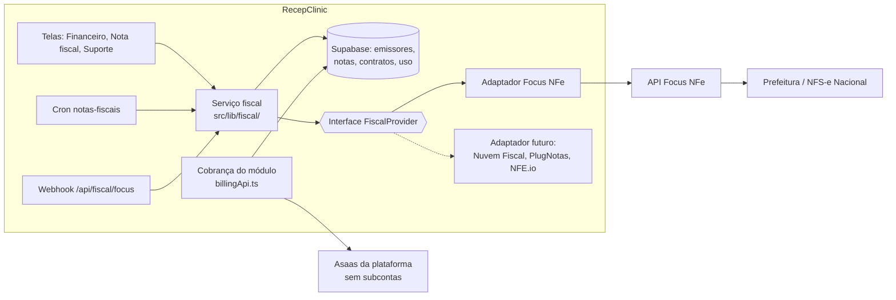
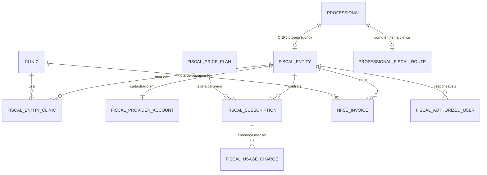
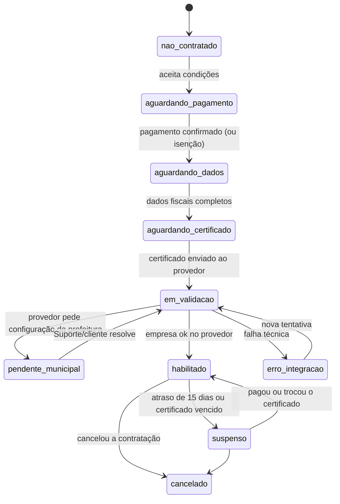

# Replanejamento do módulo fiscal (NFS-e por provedor, Focus NFe primeiro)

> 14/nov/2026. **Só planejamento; nada implementado, nenhuma migração.** Substitui, quando aprovado, a emissão pelo
> Asaas da D13 (`planejamento-nfse-asaas.md`, N1–N5). Pedido do cliente: módulo fiscal opcional, contratado e cobrado
> **por CNPJ emissor**, preços configuráveis sem deploy, provedor trocável. Marcas: **Código** = conferido no git;
> **Fonte** = página do fornecedor; **A confirmar** = depende do cliente ou do fornecedor.

## 0. Resumo em linguagem simples

- Hoje o sistema emite a nota **pelo Asaas**, com uma subconta para cada CNPJ. Isso está pronto no staging, mas nunca
  foi para a produção, e foi descartado porque a aprovação manual da subconta pesa demais.
- A proposta: um serviço especializado só em notas (**Focus NFe**) emite em nome de cada CNPJ. O RecepClinic cadastra
  a empresa e o certificado **pela API**, sem o cliente abrir outro painel. O Asaas continua só **cobrando** o módulo.
- Cerca de 60% do que já foi feito é reaproveitado: dados fiscais, tomador da nota, PDF, envio pelo WhatsApp, trilha,
  regras de quem emite. O que é exclusivo do Asaas (subconta, saldo, chave por subconta) é trocado por uma "tomada"
  de provedor, onde a Focus é o primeiro plugue.
- **Estratégia do cliente (14/nov):** implementar e testar tudo antes. Contratar o plano **Start** da Focus quando
  houver 3 clínicas usando a nota.
- **Preço inicial (cliente, 14/nov):** R$ 49,90 por mês por CNPJ, com 100 notas e R$ 0,50 por nota excedente. O
  Suporte muda os valores sem deploy. No Start, a margem fica em cerca de R$ 10 por CNPJ, mais R$ 0,39 por nota
  excedente (seção 12.1).

## 1. Diagnóstico da implementação atual

### 1.1 O que está em cada ambiente (Código)

| Item | Produção (`producao` = `cd60a03b`) | `main` / staging |
|---|---|---|
| Emissor antigo F11 (DPS direto na Sefin, certificado A1 no Vault): `clinic_fiscal_settings`, `clinic_fiscal_certificates`, `nfse_invoices`, `nfse_dps_counters`, `nfse_deliveries`, `fiscal_audit_log` | **Sim**, migrações `20261012*`/`20261013*`. **Sem notas nem certificados** (conferido na N5: a piloto não tem o financeiro) | Removido pela N5 (`20270121170000`); as tabelas de notas e a trilha ficam |
| Contrato do SaaS com preço por nota (`billing_contracts.invoice_unit_price_cents`, `invoice_monthly_allowance`, `billing_settings.default_invoice_unit_price_cents`, texto "-nf", `app.billing_invoicing_signed`) | **Sim** (`20261107120000`, `20261124120000`) | Sim |
| N1–N5 pelo Asaas: `fiscal_issuers`, `professional_fiscal_routes`, `fiscal_issuer_service_codes`, tomador em `payments`/`patient_finance`/`contact_finance`, `nfse_provider_events`, PDF no bucket, entrega automática, `fiscal_issuer_contracts`, `fiscal_usage_charges`, cron `notas-fiscais` | **Não** | Sim (6 migrações `20270121120000`–`170000`) |
| Faturamento SaaS pelo Asaas (F12): `billing_accounts`, `billing_charges`, `billing_provider_events`, `src/lib/asaas/billingApi.ts`, webhook | **Sim** | Sim |
| Preços dos planos SaaS | Fixos em `src/lib/plans.ts` (`PRICES`) | Igual |

**Consequência:** a produção não tem nenhum dado fiscal real. A troca de provedor **não precisa migrar dados de
clientes**, só o esquema. O único ponto da produção atingido é a regra do contrato SaaS com preço por nota (1.3).

### 1.2 Reaproveitamento (Código)

| Parte | Arquivos | Destino |
|---|---|---|
| Dados fiscais do emissor (CNPJ, razão social, endereço, IBGE, inscrição municipal, Simples, regime especial, CNAE, item da lista, código de tributação, NBS, ISS, PIS/COFINS) | `fiscal_issuers` (colunas fiscais), `src/lib/data/fiscalIssuers.ts`, tela `configuracoes/nota-fiscal/emissor.astro` | **Reaproveitar.** Os campos são da nota, não do Asaas. `company_type` e `monthly_income_cents` só existem pelo KYC da subconta e saem |
| Quem emite por profissional (pela clínica / próprio / não emite) | `professional_fiscal_routes`, `app.fiscal_issuer_for_professional`, `fiscal_issuer_for_appointment` | **Reaproveitar** |
| Código de tributação por serviço e emissor | `fiscal_issuer_service_codes` | **Reaproveitar** |
| Tomador da nota (CPF, e-mail, CEP e endereço do pagador) | `20270121130000`, `PayerContactFields.astro`, `set_payment_payer_contact` | **Reaproveitar inteiro** |
| Nota fiscal (estados, trilha, ligação ao pagamento) | `nfse_invoices` + colunas da N3 | **Reaproveitar.** Trocar `asaas_invoice_id`/`asaas_status` por `provider_ref`/`provider_status` genéricos e `provider` aceitar `focus` |
| PDF no bucket, envio pelo WhatsApp, entrega automática | `nfseDelivery.ts`, `nfseAutoDelivery.ts`, `20270121150000` | **Reaproveitar inteiro** (a Focus devolve PDF e XML) |
| PDF das notas antigas (DANFSe do XML) | `src/lib/nfse/danfse.ts` | Manter só para as notas `sefin` (não há nenhuma na produção) |
| Conciliação periódica (pendentes há mais de 15 min, fila de arquivos) | `src/pages/api/cron/notas-fiscais.ts`, `list_pending_asaas_invoices` | **Reaproveitar o desenho**, chamando a interface do provedor |
| Eventos do provedor (idempotência do webhook) | `nfse_provider_events`, `src/pages/api/asaas/notas.ts` | **Reaproveitar a tabela** (renomear colunas); webhook novo `/api/fiscal/<provedor>` |
| Contrato e cobrança das notas | `fiscal_issuer_contracts`, `fiscal_usage_charges`, `src/lib/data/fiscalBilling.ts`, `NotesUsageCard.astro` | **Reaproveitar parcialmente.** A estrutura (contrato por emissor, apuração mensal, cobrança avulsa no Asaas, suspensão por atraso) é a do pedido; muda o preço, que passa a vir de faixas configuráveis (seção 7) |
| Cobrança pelo Asaas da plataforma | `src/lib/asaas/billingApi.ts`, `billing_accounts` | **Reaproveitar** para cobrar o módulo (sem subconta) |

### 1.3 Dependências do Asaas a desacoplar (Código)

- `src/lib/asaas/accountsApi.ts` (cria subconta), `fiscalApi.ts` (nota pela subconta), `data/fiscalIssuerAsaas.ts`,
  `data/nfseAsaas.ts`: viram o **adaptador Asaas** ou saem (2.3).
- `fiscal_issuers`: `asaas_account_id`, `asaas_wallet_id`, `api_key_secret_id`, `webhook_token_secret_id`,
  `account_status` (KYC), `municipal_options`, `fiscal_info_*`. Viram dados **do provedor** numa tabela à parte.
- Funções `begin_/finish_asaas_invoice`, `begin_/finish_asaas_cancel`, `find_asaas_invoice`,
  `platform_link_fiscal_issuer_account`, `record_issuer_top_up` (saldo da subconta), `get_fiscal_issuer_api_key`.
- **Regra da produção:** `app.billing_invoicing_signed` e a obrigação de preço por nota no contrato SaaS quando o
  `finance` está ligado (`20261124120000`). Pelo pedido, a nota **não se mistura** com o plano. A regra sai, o texto
  "-nf" do contrato deixa de falar em nota e o módulo fiscal ganha contrato próprio (seção 7).
- Item `finance` da matriz junta "pagamentos e nota fiscal" (`src/lib/features.ts`). O módulo fiscal vira um item
  próprio (`fiscal`), que depende de `finance`, porque a nota sai do pagamento.

### 1.4 Impacto nos outros módulos

- **Financeiro:** o botão "Emitir nota" do pagamento e o tomador ficam iguais. Muda só o serviço chamado por trás.
- **Atendimento:** o emissor sai do profissional da consulta (`fiscal_issuer_for_appointment`). Não muda.
- **Cadastro do profissional:** a aba fiscal (CNPJ próprio, "Como emite") continua. Ganha o estado da contratação
  e da habilitação (seção 6).
- **Limitação atual:** só Mossoró é aceita (`app.is_supported_fiscal_municipality` = `2408003`). Com a Focus, a lista
  passa a ser a dos municípios atendidos por ela, conferida na habilitação.

## 2. Arquitetura proposta

### 2.1 Visão geral



Princípios:
1. **Três domínios separados**, como já previa a D13: *contratação* (o CNPJ pagou e aceitou), *habilitação* (o
   provedor e a prefeitura aceitam emitir) e *emissão* (as notas). A emissão só é liberada com os dois primeiros ok.
2. **A aplicação não conhece a Focus.** Só `src/lib/fiscal/providers/focus.ts` fala com ela. O resto usa a interface.
3. **Uma conta da plataforma na Focus** (modo revenda), com uma "empresa" por CNPJ emissor. O token de cada empresa
   fica no Vault, como a chave da subconta hoje.
4. **Abstração mínima:** uma interface e um adaptador real, mais o falso dos testes (como `src/lib/asaas/fake.ts`).
   Outro adaptador só quando houver motivo comercial.

### 2.2 Interface do provedor

```ts
interface FiscalProvider {
  readonly id: "focus" | "asaas";              // valor gravado em fiscal_provider_accounts.provider
  capabilities: { nationalNfse: boolean; municipalNfse: boolean; cancel: boolean; webhooks: boolean; certificateViaApi: boolean };
  registerCompany(issuer: IssuerData): Promise<{ providerRef: string; token: string }>;
  updateCompany(ref: ProviderAccount, issuer: IssuerData): Promise<void>;
  uploadCertificate(ref: ProviderAccount, pfx: Uint8Array, password: string): Promise<{ validUntil: Date; holderCnpj: string }>;
  getCompanyStatus(ref: ProviderAccount): Promise<HabilitationStatus>;   // habilitado, pendências municipais
  issue(ref: ProviderAccount, invoice: NewInvoice): Promise<IssueResult>; // assíncrono: "processando"
  getInvoice(ref: ProviderAccount, providerRef: string): Promise<ProviderInvoice>;
  cancel(ref: ProviderAccount, providerRef: string, reason: string): Promise<CancelResult>;
  getFiles(ref: ProviderAccount, providerRef: string): Promise<{ pdf?: Uint8Array; xml?: string }>;
  parseWebhook(req: Request): Promise<ProviderEvent | null>;             // valida a origem
}
```

- `NewInvoice` e `ProviderInvoice` são do RecepClinic: tomador, serviço, valores, tributos, referência idempotente =
  id da nota. Cada adaptador traduz. As diferenças entre provedores (campos por município, NFS-e Nacional × municipal,
  cancelamento por prazo) aparecem em `capabilities` e em erros com código próprio, nunca presumidas iguais.
- Erros normalizados: `rejected` (dado errado, a recepção corrige), `transient` (rede/5xx, tenta de novo),
  `not_enabled` (habilitação pendente), `unknown` (conciliação). É a regra que a revisão da N3 já fixou para o Asaas.

### 2.3 O que fazer com o adaptador Asaas

Recomendação: **não manter** a emissão pelo Asaas como adaptador. Ela depende de subconta, que foi o motivo da troca.
O código sai na etapa de limpeza (P8), e o histórico fica no git. Decisão pendente **DP-3**.

## 3. Modelo de dados

### 3.1 Ponto central: o CNPJ emissor não pertence a uma clínica só

Hoje `fiscal_issuers` tem `clinic_id` obrigatório e um CNPJ por clínica. O pedido diz que o CNPJ do profissional pode
servir a mais de uma clínica, e a Focus aceita **uma empresa por CNPJ** na conta da plataforma. Por isso, o CNPJ precisa
existir uma vez só na plataforma, e cada clínica se liga a ele.



| Tabela | Conteúdo | Observação |
|---|---|---|
| `fiscal_issuers` (evolui; vira a "entidade") | CNPJ **único na plataforma**, dados fiscais, `owner_kind` (`clinic`/`professional`), clínica dona ou profissional dono, estado da habilitação, validade do certificado | Sai o `clinic_id` obrigatório e a unicidade por clínica. `unique (cnpj)` |
| `fiscal_issuer_clinics` (nova) | `issuer_id`, `clinic_id`, quem ligou, quando | Liga o CNPJ às clínicas onde emite. O CNPJ da clínica tem uma linha só, a própria clínica |
| `fiscal_provider_accounts` (nova) | `issuer_id`, `provider`, `environment`, `provider_ref`, `token_secret_id` (Vault), `status`, `last_error`, `synced_at` | Tudo que era `asaas_*` no emissor. Trocar de provedor = linha nova |
| `fiscal_authorized_users` (nova, só se DP-2 pedir) | Quem administra o CNPJ além do dono | No começo: o Administrador da clínica dona ou o próprio profissional (regra N-P2 de hoje) |
| `professional_fiscal_routes`, `fiscal_issuer_service_codes` | Iguais | O código por serviço passa a ser por (emissor, clínica, serviço) |
| `nfse_invoices` | `issuer_id` + `clinic_id` + pagamento; `provider_ref`, `provider_status` | A nota pertence à clínica do pagamento **e** ao CNPJ. RLS pela clínica (D1), e o dono do CNPJ vê as dele |
| `fiscal_price_plans`, `fiscal_price_tiers`, `fiscal_subscriptions`, `fiscal_subscription_changes`, `fiscal_usage_periods`, `fiscal_usage_charges` | Seção 7 | `fiscal_issuer_contracts` vira `fiscal_subscriptions` |
| `fiscal_provider_costs` (nova) | Custo do provedor por mês (fatura da Focus) e rateio por CNPJ | Seção 8 |

### 3.2 Isolamento (D1 e LGPD)

- **Nota:** visível só para a clínica do pagamento e para o dono do CNPJ. A clínica A nunca vê as notas que o mesmo
  médico emitiu na clínica B. O médico vê as dele em todas.
- **Dados do CNPJ** (endereço, certificado, contrato): o dono e o Suporte. A clínica que só usa um CNPJ de profissional
  vê o nome, o CNPJ e o estado ("habilitado"), e mais nada.
- **Franquia:** conta por CNPJ, somando todas as clínicas.
- Regra técnica: toda leitura passa por funções `app.can_*` (padrão atual) e testes de RLS por papel e por clínica.

## 4. Fluxos de contratação e habilitação

### 4.1 Estados



- O estado mostrado é **derivado** de dois campos: estado comercial (`fiscal_subscriptions.status`) e estado da
  habilitação (`fiscal_provider_accounts.status` + validade do certificado). Não existe uma coluna única que possa
  ficar fora de sincronia.
- **Emissão liberada** = contratação ativa (ou isenta) **e** empresa habilitada **e** certificado válido **e** o
  Administrador ligou a emissão. Uma função do banco (`app.fiscal_can_issue`) decide, e o servidor e a tela leem dela.
- **Dados e certificado antes do pagamento?** Recomendação (DP-4): deixar preencher em qualquer ordem e cobrar só na
  liberação. O cliente vê tudo pronto antes de pagar, e o Suporte não cobra quem não consegue habilitar.

### 4.2 Sequência da habilitação

```mermaid
sequenceDiagram
  participant U as Admin/Profissional
  participant RC as RecepClinic (servidor)
  participant V as Vault
  participant F as Focus NFe
  U->>RC: dados fiscais + certificado .pfx + senha
  RC->>RC: lê validade e CNPJ do .pfx na memória; confere com o CNPJ do emissor
  RC->>F: cria/atualiza empresa (dados + certificado + senha)
  F-->>RC: id da empresa + token da empresa
  RC->>V: guarda o token (nunca o .pfx nem a senha)
  RC->>F: consulta situação (cron até habilitar)
  F-->>RC: habilitada / pendências do município
  RC-->>U: estado na tela; aviso por e-mail ao habilitar
```

### 4.3 Renovação, inadimplência, cancelamento, troca de certificado

- **Renovação:** mensal e automática pelo Asaas. A apuração do mês anterior sai no começo do mês (regra da N4b).
- **Inadimplência:** cobrança vencida há 15 dias suspende só aquele CNPJ (regra N-P5). Paga, volta sozinha. As notas já
  emitidas continuam visíveis e podem ser canceladas.
- **Cancelamento:** fim no último dia do período pago. A empresa fica inativa na Focus (sem apagar, porque as notas
  ficam guardadas lá). O token sai do Vault.
- **Troca de certificado:** pode ser feita a qualquer momento. Avisos aos 30, 15 e 7 dias do vencimento. Vencido,
  bloqueia a emissão com a mensagem "certificado vencido".

## 5. Integração com a Focus NFe

O que as fontes confirmam:
- API REST v2. Na revenda, o token principal da plataforma cadastra empresas pela API, inclusive o certificado
  ([guia da empresa emitente](https://focusnfe.com.br/guides/criacao-empresa-emitente/),
  [vincular certificado](https://focusnfe.com.br/blog/como-vincular-o-certificado-digital-modelo-a1-a-empresa-cadastrada/)).
- Só certificado **A1**.
- **Mossoró (conferido pelo cliente e no [guia](https://focusnfe.com.br/guides/nfse/municipios-integrados/mossoro-rn/)):**
  ambiente municipal, provedor **Tinus**, padrão próprio ABRASF, autenticação por certificado digital, cancelamento
  "Ativo" (prazo não citado). Campos: endereço do tomador obrigatório, CPF/CNPJ do tomador opcional, item da lista
  (LC 116) e CNAE obrigatórios, código tributário do município não usado. O exemplo também tem `inscricao_municipal`,
  `optante_simples_nacional`, `regime_tributario_simples_nacional` (1/2/3), `codigo_nbs`, `iss_retido` e o bloco
  IBS/CBS da Reforma. Todos já existem em `fiscal_issuers` ou no tomador (1.2), menos o regime de apuração do
  Simples. **Homologação:** a tabela diz "Sim", mas o portal de testes está "Não disponível" (A confirmar com a Focus).
  O guia avisa que o MEI e o Simples Nacional têm prazo para sair do ambiente municipal e ir para o Nacional.
- NFS-e Nacional em `/v2/nfsen`, com outro payload e habilitação por ambiente
  ([NFS-e Nacional](https://focusnfe.com.br/produtos/nfse-nacional/)). Para o Simples Nacional, o ambiente nacional
  tende a ser obrigatório a partir de nov/2026.

**A confirmar em homologação (etapa P1):** nomes exatos dos campos do certificado na criação da empresa; se a resposta
traz a validade; formato e assinatura do webhook; prazo de cancelamento em Mossoró; se o PDF vem como arquivo ou como
link; o que a Focus conta como "nota" (rejeitada e cancelada contam?).

Estratégia:
1. **Nacional ou municipal?** O adaptador escolhe pelo município e pelo regime, com uma tabela
   `fiscal_municipalities` (IBGE, modelo, provedor que atende), mantida pelo Suporte. Começa só com Mossoró.
2. **Idempotência:** a referência enviada à Focus é o id da nota. Repetir o envio não duplica a nota.
3. **Assíncrono:** emitir devolve "processando". A confirmação chega pelo webhook e, como reserva, pelo cron de 10 min
   que já existe.
4. **Ambientes:** homologação no staging e produção na produção. Os tokens ficam separados por ambiente, como hoje.

## 6. Interfaces

### 6.1 Clínica e profissional (`/admin/configuracoes/nota-fiscal`)
- A lista de CNPJs emissores da clínica (o dela e os dos profissionais ligados) tem, para cada um, estado, franquia
  do mês (por exemplo, "23 de 30") e próximo passo ("Enviar certificado", "Pagar").
- Página do emissor com as abas **Dados fiscais · Certificado · Contratação · Uso**. Reaproveita a tela atual
  `emissor.astro`.
- Contratação: escolha da faixa, condições com aceite (o padrão da N4b) e pagamento pelo `PaymentStep.astro` do
  faturamento.
- Profissional com CNPJ próprio: as mesmas telas, vendo só o próprio CNPJ.

### 6.2 Suporte (`/admin/sistema/...`)
- **Tabela de preços fiscal:** as faixas, o valor do excedente, a implantação, a disponibilidade por plano comercial e
  um interruptor para ligar ou desligar a cobrança. As alterações têm data de início e não mexem nos contratos já
  aceitos sem novo aceite.
- **CNPJs emissores:** busca e filtros por estado e provedor (pensando em 10+ por clínica). Mostra a situação comercial
  e fiscal, o valor, a franquia e o consumo, o custo do provedor, a receita e os erros recentes.
- **Condição especial** por CNPJ ou clínica: desconto (% ou R$), isenção com prazo e preço personalizado (faixa "acima
  de 300"). Tudo fica no histórico.
- **Indicadores:** CNPJs ativos, notas por mês, receita recorrente, custo do provedor, margem, rejeições e certificados
  vencendo. Visão geral e visão por CNPJ.

## 7. Cobrança e preço configurável

```mermaid
erDiagram
  FISCAL_PRICE_PLAN ||--o{ FISCAL_PRICE_TIER : faixas
  FISCAL_PRICE_PLAN { text nome; date vigente_de; date vigente_ate; int implantacao_cents; bool cobranca_ligada; text_array planos_comerciais }
  FISCAL_PRICE_TIER { int ate_notas; int mensal_cents; int excedente_cents; text modo_excedente }
  FISCAL_SUBSCRIPTION { uuid issuer; text status; int mensal_cents; int franquia; int excedente_cents; int desconto; date isento_ate; date inicio; date proxima_cobranca }
```

- **Tabela de preços** (`fiscal_price_plans` + `fiscal_price_tiers`): é editada pelo Suporte e tem vigência. Ela aceita
  uma ou várias faixas. **O preço inicial decidido pelo cliente (14/nov) é uma faixa só: R$ 49,90 por mês por CNPJ,
  com 100 notas e R$ 0,50 por nota excedente.** Ele entra **como dado de seed**, nunca como constante no código, e o
  Suporte muda os valores (ou cria faixas) sem deploy.
- **Contratação** (`fiscal_subscriptions`): é uma **cópia** dos valores no momento do aceite (como o
  `plan_snapshot` do contrato SaaS). Mudar a tabela não altera quem já contratou. A condição especial muda só a cópia
  daquele CNPJ e exige novo aceite quando o preço sobe.
- **Histórico** (`fiscal_subscription_changes`): registra cada mudança de valor, faixa, desconto ou estado, com quem
  mudou e quando. A trilha `app.audit_platform_staff_write` já existe.
- **Excedente (DP-5, decidido):** a nota que passa da franquia é **cobrada por nota**, pelo valor da contratação
  (inicialmente R$ 0,50). Isso entra na cobrança do mês seguinte, junto da mensalidade do CNPJ. O modo do excedente
  fica configurável na faixa (`por_nota`, `sobe_faixa`, `bloqueia`). O código começa só com o `por_nota`, e os outros
  dois ficam para quando forem pedidos.
- **Cobrança:** o Asaas **da plataforma** (`billingApi.ts`), com o cliente Asaas de quem paga. Para o CNPJ da clínica, o
  `billing_accounts` dela é reaproveitado. Para o profissional, um cliente Asaas próprio (`asaas_customer_id`, que já
  existe em `fiscal_issuer_contracts`). Assinatura mensal no Asaas com valor da faixa contratada e, se houver, uma
  cobrança avulsa de ajuste. Fica **separada** da mensalidade do SaaS, sem item na mesma fatura.
- **Disponível por plano comercial:** é uma coluna da tabela de preços, mais o item `fiscal` na matriz de acesso (D11).
- **O que sai do contrato SaaS:** `invoice_unit_price_cents` e `invoice_monthly_allowance` deixam de ser exigidos
  e ficam nulos. O texto "-nf" volta ao texto sem nota. É uma mudança na produção, mas sem efeito para clientes, porque
  nenhum contrato da produção usa nota (A confirmar por consulta de leitura antes da migração).

## 8. Franquia, consumo e custo

Há duas contagens independentes por CNPJ e por mês (`fiscal_usage_periods`):

| Contagem | Para quê | Regra |
|---|---|---|
| **Consumo comercial** | Faixa e preço do módulo | Notas autorizadas no mês. A cancelada conta, a rejeitada não (regra atual da N4b, revisável na DP-6) |
| **Consumo do provedor** | Custo real | O critério do contrato da Focus (A confirmar), lido da fatura dela ou calculado pelos eventos |

- **Alertas** aos 80% e aos 100% da faixa, por e-mail ao responsável e na tela.
- **Custo:** a fatura da Focus é registrada por mês (`fiscal_provider_costs`). No Growth, o fixo é rateado pelos CNPJs
  ativos e o excedente pelas notas. A margem por CNPJ é a receita menos o custo rateado.
- O excedente da franquia comercial nunca bloqueia a nota, a menos que a DP-5 escolha o bloqueio.

## 9. Segurança e LGPD

- **Certificado:** o .pfx e a senha passam pelo servidor **só na memória**, no mesmo pedido que os envia à Focus. Nada
  vai para o banco, o bucket ou os logs. O sistema guarda a validade, o CNPJ do titular, a data de envio e quem enviou.
  O padrão vale também para a troca. Se a Focus recusar, o usuário envia de novo.
- **Token da empresa na Focus:** fica no Vault, lido só por função `service_role` (padrão `get_fiscal_issuer_api_key`).
  O token principal da revenda fica em variável de ambiente da plataforma (L39).
- **Webhook:** valida um segredo próprio por ambiente, registra o evento antes de processar e ignora repetidos.
- **Perfis:** o Administrador e o dono do CNPJ configuram, a Recepção emite e cancela (como hoje), o Suporte vê tudo e
  muda preços. Toda operação fiscal entra na `fiscal_audit_log`.
- **LGPD:** a Focus passa a ser **operadora** de dados de pacientes (nome, CPF, endereço). Precisa entrar na política de
  fornecedores do BaaS (frente Segurança, S-políticas de 13/nov), no termo de tratamento de dados e no contrato com as
  clínicas (advogado). A guarda do certificado na Focus deve aparecer no aceite do módulo: "o certificado é enviado ao
  provedor fiscal e não fica no RecepClinic".
- **Logs:** sem CPF, nome ou valores, só ids (L43).

## 10. Plano de migração do modelo atual

| Ambiente | O que acontece |
|---|---|
| Produção | Recebe direto o esquema novo (as 6 migrações N1–N5 **mais** as novas), nunca o código do Asaas fiscal ligado. Sem dados a converter. A única mudança visível é a regra do contrato SaaS (7, último item) |
| Staging | As migrações novas transformam `fiscal_issuers` (sai o `clinic_id` obrigatório, entram as tabelas de ligação e do provedor) e copiam os dados de teste da Clínica Exemplo. Os dados do Asaas Sandbox (subconta do Dr. Bruno) são apagados com o token dele no Vault |
| Código | A emissão pelo Asaas segue desligada no staging até a P4. Na P8, sai o código do Asaas fiscal |

**Alternativa (DP-3):** reverter as 6 migrações antes e recriar tudo do zero. Não é recomendada: dá mais trabalho, joga
fora testes que passam (1226 + 1153) e o resultado final é o mesmo.

## 11. Decisões pendentes (cada uma com recomendação)

| # | Decisão | Recomendação | Bloqueia |
|---|---|---|---|
| **DP-1** ✅ | Plano da Focus | **Decidido (cliente, 14/nov): implementar e testar tudo; contratar o Start quando houver 3 clínicas emitindo.** Os preços de venda ficam para o cliente, na tabela configurável (seção 12) | — |
| **DP-2** ✅ | O CNPJ do profissional é contratado uma vez e usado em várias clínicas (um preço, uma franquia), ou uma contratação por clínica? | **Decidido (cliente, 14/nov): uma contratação por CNPJ, valendo em todas as clínicas; franquia somada; cada clínica vê só as notas dela, o dono vê todas** | — |
| DP-3 | Destino do código N1–N5 | Evoluir as migrações e tirar o código do Asaas fiscal na P8 | Plano de migração |
| DP-4 | Ordem: pagar antes ou depois de habilitar | Preencher em qualquer ordem e cobrar ao liberar | Fluxo |
| DP-5 ✅ | Excedente da franquia | **Decidido (cliente, 14/nov): R$ 0,50 por nota excedente, parametrizável** | — |
| DP-6 | Cancelada conta na franquia comercial? | Sim (a do provedor também conta) | Franquia |
| DP-7 | Quem administra o CNPJ do profissional numa clínica que só o usa | Só o dono. A clínica vê o estado | Permissões |
| DP-8 | Implantação fiscal (taxa única) | Pode ser configurada e começa em R$ 0 | Não bloqueia |
| DP-9 | O módulo fica em qual plano comercial | Disponível nos dois, como adicional | Não bloqueia |
| DP-10 | Rever a D13 na `arquitetura.md` | Nova D15 "Nota fiscal por provedor fiscal, cobrada por CNPJ"; a D13 fica como descartada | Só documentação |

## 12. Riscos

| Risco | Tipo | Efeito | Mitigação |
|---|---|---|---|
| Custo da Focus maior que a receita | Comercial | Ver a conta abaixo da tabela | Tabela de preços configurável; painel de margem (P7); trocar de plano da Focus por volume |
| Prefeitura exige configuração manual (senha do portal, inscrição) | Técnico | O CNPJ fica "pendente municipal" | Estado próprio, instruções por município, Suporte acompanha |
| NFS-e Nacional obrigatória para o Simples (nov/2026) | Fiscal | Muda payload e habilitação | O adaptador já escolhe o modelo por município e regime |
| Certificado vencido | Operacional | A emissão para | Avisos 30/15/7 e bloqueio claro |
| Dependência de um fornecedor | Estratégico | Troca cara | A interface já isola; as notas antigas ficam com o PDF e o XML no bucket |
| Contador (PIS/COFINS, IBS/CBS) e advogado (operador de dados, contrato) | Externo | Atrasa a produção | Já são bloqueios da frente; seguem |
| Regra do contrato SaaS na produção | Técnico | Migração toca contrato vigente | Consulta de leitura antes; migração só remove a obrigação |

### 12.1 Conta do custo (preços da Focus em 14/nov, [página de preços](https://focusnfe.com.br/precos/))

| Plano Focus | Mensal | CNPJs | Documentos | Excedente |
|---|---:|---|---|---|
| Solo | R$ 94,90 | 1 | 100 | R$ 0,11/doc |
| **Start** | **R$ 119,90** | **3** (+ R$ 39,90 por CNPJ a mais) | **100 por CNPJ** | R$ 0,11/doc |
| Growth | R$ 572,00 | ilimitados | 4.000 somados | R$ 0,125 a R$ 0,084/doc, por faixa |

Na Focus, não há taxa de setup nem fidelidade.

- **No Start, com 3 CNPJs:** o custo é R$ 119,90, ou seja, cerca de R$ 39,97 por CNPJ com até 100 notas. Com os preços
  de exemplo (R$ 19,90 / 29,90 / 49,90), **toda faixa dá prejuízo**: a de 300 notas custa cerca de R$ 61,97 (R$ 39,97
  + 200 × R$ 0,11) e é vendida a R$ 49,90.
- **Cada CNPJ além do 3º** custa R$ 39,90 mais o excedente. O preço precisa passar disso.
- **Mudar para o Growth** compensa a partir de uns **15 CNPJs** (R$ 119,90 + R$ 39,90 × 12 = R$ 598,70, acima de
  R$ 572). No Growth, R$ 19,90 por CNPJ só empata a partir de uns **29 CNPJs**.
- **Preço inicial decidido (R$ 49,90, 100 notas, R$ 0,50 por excedente):** no Start, a margem é de cerca de R$ 9,93
  por CNPJ por mês (R$ 49,90 − R$ 39,97). Cada nota excedente rende R$ 0,39 (R$ 0,50 − R$ 0,11). Cada CNPJ além do 3º
  deixa cerca de R$ 10. **Não dá prejuízo em nenhum volume.** Exemplo: um CNPJ com 250 notas paga R$ 124,90 (49,90 +
  150 × 0,50) e custa cerca de R$ 56,47 (39,97 + 150 × 0,11).
- **Antes do 3º CNPJ:** se o Start for contratado com 1 ou 2 clínicas, o fixo de R$ 119,90 fica maior que a receita
  (R$ 49,90 ou R$ 99,80). Por isso, a estratégia é esperar as 3 clínicas.

## 13. Etapas (pequenas; cada uma com validação e parada)

| Etapa | Entrega | Testes |
|---|---|---|
| **P0** | Conta de testes da Focus (cliente; confirmar se a homologação de Mossoró funciona sem plano pago); D15 escrita | — |
| **P1** | Prova de conceito só no staging: adaptador Focus com o falso, cadastro de empresa, certificado de teste e emissão em homologação (Mossoró) por script. Responde os "A confirmar" da seção 5 | Unidade do adaptador (payload, erros normalizados); 1 emissão real em homologação |
| **P2** | Migração do modelo: CNPJ único, `fiscal_issuer_clinics`, `fiscal_provider_accounts`, colunas genéricas em `nfse_invoices`/`nfse_provider_events`, item `fiscal` na matriz | `test:db` de RLS por clínica e por dono do CNPJ; o mesmo CNPJ em duas clínicas sem vazamento |
| **P3** | Habilitação: telas Dados fiscais e Certificado, envio à Focus, cron de situação, estados | Playwright da página do emissor (dados preservados no erro, Voltar); unidade do .pfx (validade, CNPJ diferente recusado); falso da Focus |
| **P4** | Emissão, consulta, cancelamento, PDF/XML e webhook pela interface; reaproveita a entrega pelo WhatsApp | Unidade do serviço fiscal; idempotência do webhook; conciliação após 15 min; Playwright do pagamento → nota |
| **P5** | Tabela de preços e condições especiais (Suporte), com vigência e histórico | `test:db` (cópia no aceite, novo aceite quando o preço sobe); Playwright da tela do Suporte |
| **P6** | Contratação e cobrança pelo Asaas da plataforma (assinatura do módulo por CNPJ), suspensão por atraso e reativação | Unidade da apuração (faixas, excedente, desconto, isenção); falso do Asaas; webhook de pagamento |
| **P7** | Consumo, alertas de franquia e certificado, custo do provedor, painel e indicadores do Suporte | `test:db` das duas contagens; Playwright do painel (busca e filtro) |
| **P8** | Limpeza: código do Asaas fiscal, regra de nota no contrato SaaS, `billing_settings.default_invoice_unit_price_cents`, Central de Ajuda (com autorização para recapturar) | Suíte inteira; `astro check` |
| **P9** | Produção com 1 CNPJ-piloto (só com autorização) | Roteiro de validação com nota real |

As etapas P1 a P4 já entregam a emissão funcionando. As P5 a P7 entregam a parte comercial. Pode ser liberado com
isenção (P5) antes da cobrança automática (P6).

## Fontes (consultadas em 14/nov/2026)
- [Focus NFe: preços](https://focusnfe.com.br/precos/) · [simulador Growth](https://focusnfe.com.br/precos/simulador-growth/)
- [Focus NFe: cadastro da empresa emitente](https://focusnfe.com.br/guides/criacao-empresa-emitente/) ·
  [configurando a empresa](https://focusnfe.com.br/guides/configurando-empresa/) ·
  [certificado A1](https://focusnfe.com.br/blog/como-vincular-o-certificado-digital-modelo-a1-a-empresa-cadastrada/)
- [Focus NFe: Mossoró/RN](https://focusnfe.com.br/guides/nfse/municipios-integrados/mossoro-rn/) ·
  [NFS-e Nacional](https://focusnfe.com.br/produtos/nfse-nacional/)
- Comparativo de terceiro, usado só como indício: [Notaas](https://www.notaas.com.br/blog/post/focus-nfe-api-precos-planos-cidades-homologadas-alternativa-comparativo-notaas-2026/)
